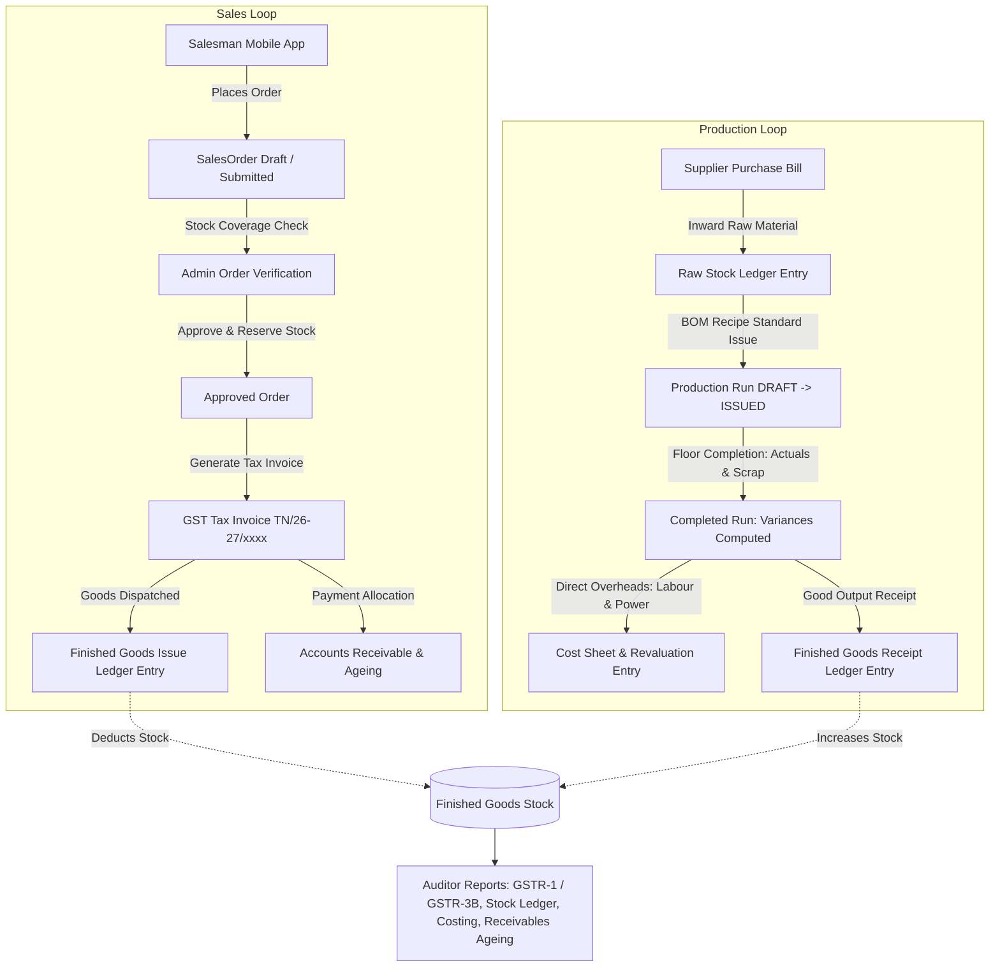
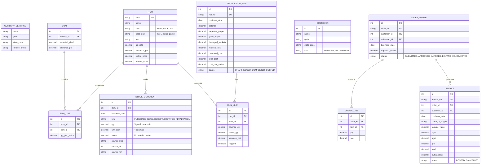

# Order-to-Audit System — Architecture & Design Note
**Client:** Sri Lakshmi Snacks (Small Food Manufacturer, Tamil Nadu)  
**Evaluation:** Centre for Digital Infrastructure, NIT Tiruchirappalli — Winter 2026 Internship  
**Author:** Candidate Solution  

---

## 1. System Overview: The Two Loops

The Order-to-Audit system carries a small packaged food manufacturer from field order placement on mobile devices to the auditor's monthly statutory reports. Daily operations operate without any external accounting dependencies (such as Tally), while supporting standard audit exports.

Both loops converge at **Finished Goods Stock (`StockMovement`)**. Finished goods increase upon production completion and decrease upon invoice dispatch.

---

## 2. Entity-Relationship (ER) Data Model

---

## 3. Core Accounting, Inventory & Costing Logic

### 3.1 The Append-Only Stock Movement Ledger
Stock is never stored as an editable balance column on item rows. Every change is an immutable entry in `StockMovement`.
* **Single Writer:** `ota.services.ledger.post_movement()` is the sole entry point for inventory mutations. It acquires a row lock (`select_for_update`), reads current `SUM(qty)` and `SUM(value)`, and enforces non-negative stock.
* **Valuation Method:** Moving Weighted Average:
  $$\text{Average Rate} = \frac{\sum \text{Movement Value}}{\sum \text{Movement Qty}}$$
  *Compliant with Indian Accounting Standard (Ind AS 2 / AS 2).* Part-batches and sequential purchase lots are naturally averaged without complex cost layering (FIFO) or distortion of historical stock (Last Price).
* **Immutability & Corrections:** Posted ledger rows and invoices are never edited or deleted. An invoice correction is made via a formal `CreditNote`, which posts an opposite entry returning dispatched finished goods at current average cost.

### 3.2 Recipe-Based BOM & Variance Analysis
1. **Lifecycle:** `DRAFT` (snapshots BOM lines) $\rightarrow$ `ISSUED` (deducts raw stock at moving average) $\rightarrow$ `COMPLETED` (records packaging and finishes goods receipt) $\rightarrow$ `COSTED` (allocates overheads).
2. **Variance Calculation:**
   $$\text{Variance \%} = \frac{\text{Actual Qty} - \text{Planned Qty}}{\text{Planned Qty}} \times 100$$
3. **Strict Tolerance Rule:** Variance is flagged **strictly greater than** the threshold:
   - 200g Pouches: $194$ used vs $200$ planned is exactly $-3.00\%$ $\rightarrow$ **Within tolerance (Not flagged)**.
   - Cartons: $9$ used vs $10$ planned is $-10.00\%$ $\rightarrow$ **Flagged as Favourable** ($188$ packets legitimately fit into $9.4$ cartons).
   - Cooking Oil: $10.5\text{ L}$ vs $10.0\text{ L}$ is $+5.00\%$ $\rightarrow$ **Flagged as Adverse**.
4. **Unit Cost Per Packet:**
   $$\text{Cost Per Packet} = \frac{\text{Total Run Cost (Materials + Overheads)}}{\text{Good Packets Produced}} = \frac{₹5,855.00}{188} = ₹31.14$$
   Yield loss is intentionally absorbed into sellable packets rather than segregated into obscure write-offs.

### 3.3 GST Engine & Invoice Numbering
* **Place of Supply:** Buyer state code (extracted from GSTIN prefix or master) is matched against the factory's Tamil Nadu code (`33`):
  - Same State (`33`): CGST ($2.5\%$) + SGST ($2.5\%$).
  - Interstate (`29` Karnataka): IGST ($5\%$).
* **Financial Year Sequencing:** Unique sequence reset annually on April 1st (e.g. `TN/26-27/0001`), within the statutory 16-character limit.

---

## 4. Benchmark Verification Summary (Section 5)

All 20 Section 5 assertion checks pass with zero variance:
* Flour Closing: $120.000\text{ kg}$ @ moving average $₹43.1250$
* Oil Closing: $19.500\text{ L}$ | Spice Closing: $3.800\text{ kg}$
* Pouches Closing: $306\text{ pcs}$ | Cartons Closing: $21\text{ pcs}$
* Finished Goods Post-Run: $238\text{ pkts}$ | Post-Retailer A Dispatch: $88\text{ pkts}$
* Retailer A Invoice: $₹7,875.00$ ($₹7,500$ taxable + $₹187.50$ CGST + $₹187.50$ SGST) | Outstanding: $₹3,875.00$
* Distributor B Shortage: $32\text{ packets}$ flagged with IGST ($₹300.00$)
* Total Cost Sheet: Materials $₹4,055$ + Labour $₹1,200$ + Power $₹600$ = $₹5,855 \div 188 = ₹31.14/\text{pkt}$ (Wholesale Margin $₹18.86$, $37.7\%$).
